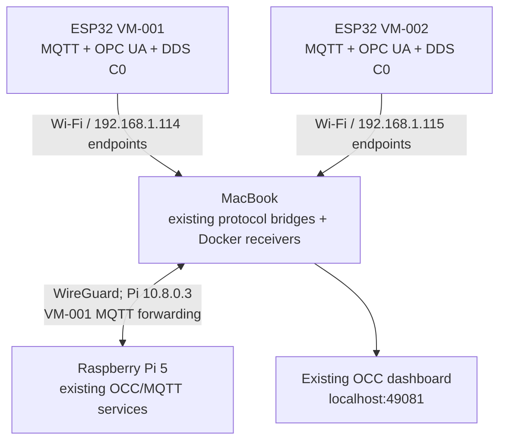

# OCC Cybersecurity Protocol Evaluation Testbed
## Deployment, Operation and Handover Manual

**Host research context:** OVGU Magdeburg internship / TU Chemnitz M.Sc. Information & Communication Systems  
**Hardware:** Raspberry Pi 5 OCC host; ESP32 VM-001 and VM-002  
**Protocols:** MQTT, OPC UA, DDS  
**Document version:** 1.0 — 17 October 2026  
**Validated operating mode:** Two physical ESP32 vehicles, **C0** telemetry over all three protocols, existing **macOS + Raspberry Pi** environment  
**Scope:** Existing testbed deployment and handover. SmartRegion/AAS and robot/ROS 2 integration are not part of this manual.

> **Read this first:** On 17 October 2026, the existing Mac-based system recovered all **six C0 live feeds** after `occ stop` / `occ start`. The **C1/C2 tests and metrics are existing offline evaluation artifacts**; no continuous C1/C2 dashboard is required. The one-click starter has **not** been independently validated as a complete fresh installation on Ubuntu or a different Mac. The starter ZIP **alone is not a full portable testbed image**. A migration needs the repository, local bridge scripts, Docker runtime/images and state, the verified DDS reader patch, configuration, and network access.

---

## 1. Purpose and boundaries

This README enables an operator to:

1. Identify the OCC testbed components and their network dependencies.
2. Start, check and stop the **existing** working Mac deployment with a single command.
3. Prepare a **second Mac** for deployment without rebuilding the security experiments.
4. Troubleshoot startup failures without deleting historical KPI data.
5. Explain to a supervisor how the testbed could be migrated to Ubuntu/Linux, while clearly marking that deployment as **optional and not yet acceptance-tested**.

The live demonstration uses **C0** for VM-001 and VM-002. The pre-existing C1/C2 measurements should be shown as saved graphs/tables. Do **not** re-run C1/C2 experiments merely to bring up the dashboard.

## 2. System topology and component responsibilities



**VM-001:** ESP32 connects to the Mac's `192.168.1.114` address. MQTT C0 is relayed to Raspberry Pi Mosquitto across WireGuard and mirrored to local Docker MQTT; OPC UA uses the local TCP bridge, and DDS uses a dedicated UDP relay plus isolated XRCE-DDS receiver/observer.

**VM-002:** ESP32 connects to the Mac's `192.168.1.115` **IP alias**. Its local bridge forwards MQTT, OPC UA and DDS traffic into the existing Docker runtime.

**MacBook:** Runs Docker Desktop, the eight-container OCC Compose project, the local gateway and five bridge/observer processes. The dashboard is bound to **the Mac's localhost**, not automatically accessible on another computer.

**Raspberry Pi:** Runs the existing MQTT/OCC services. In the validated setup the Mac can reach the Pi at **WireGuard address `10.8.0.3`**. The Pi can use a different physical Wi-Fi network if the WireGuard tunnel is working.

### Validated network endpoints (current lab configuration)

| Component / path | Address or port | Notes |
|---|---|---|
| Mac interface for VM-001 | `192.168.1.114` | Must be on active `en0` LAN in current launcher |
| VM-001 ESP32 (previously observed) | `192.168.1.113` | DHCP address may change |
| VM-002 ESP32 (previously observed) | `192.168.1.110` | DHCP address may change |
| Mac interface for VM-002 | `192.168.1.115` | Additional IP alias; verify no collision |
| VM-001 MQTT C0 entry | `.114:1883/TCP` | Shared gateway relays to Pi MQTT `10.8.0.3:1883` |
| VM-001 OPC UA C0 entry | `.114:14840/TCP` | Bridge to local Docker OPC UA receiver |
| VM-001 DDS C0 entry | `.114:8888/UDP` | Dedicated relay and isolated receiver |
| VM-002 MQTT C0 entry | `.115:1883/TCP` | VM-002 bridge to Docker MQTT |
| VM-002 OPC UA C0 entry | `.115:14840/TCP` | VM-002 bridge to Docker OPC UA |
| VM-002 DDS C0 entry | `.115:8888/UDP` | VM-002 bridge to Docker DDS |
| Raspberry Pi via WireGuard | `10.8.0.3` | Existing tunnel; Pi MQTT ports `1883/1884/8883` |
| Local Docker MQTT C0 | `127.0.0.1:42883` | Host-published receiver |
| Local Docker OPC UA C0 | `127.0.0.1:45840` | Host-published receiver |
| Local Docker DDS C0 | `127.0.0.1:49888/UDP` | VM-002 path; VM-001 uses isolated agent |
| OCC REST API | `http://127.0.0.1:49080/` | Local to Mac |
| OCC dashboard | `http://127.0.0.1:49081/` | Local to Mac |

**Network rule:** For the **current** firmware and launch script, ESP32s must be able to route to `.114/.115`; using the same `192.168.1.0/24` Wi-Fi is the validated case. Different SSIDs / different networks are **not yet a supported drop-in mode**; they require routing, relaying or updating destination endpoints. Do not assign `.114` or `.115` if those addresses are occupied by other hosts.

## 3. Prerequisites

### Hardware

- Mac with compatible macOS and sufficient resources for Docker Desktop.
- Raspberry Pi 5, correctly powered, with existing OCC services and WireGuard access.
- ESP32 VM-001 and/or VM-002, **already flashed** with the validated C0 selectable/unified firmware and saved network settings.
- A network providing reachability for ESP32-to-Mac endpoints and Mac-to-Pi WireGuard.

### Software / runtime

- Docker Desktop and the `docker` / `docker compose` CLI; Docker must be started before, or be startable by, the launcher.
- Python 3; **the validated development host used Python 3.12.7**. Python dependencies for the bridge scripts must be installed into the interpreter used by `~/.local/bin/occ` (the launcher invokes its own `sys.executable` for workers). Use the dependency specifications associated with the actual copied bridge sources; do not guess a complete requirements list.
- Git and the original OCC repository and runtime export.
- WireGuard client/profile for accessing the Pi (`10.8.0.3`).
- Operator permissions for Docker and, when needed, adding a macOS `en0` IP alias (`sudo`) and starting the existing SNTP service.

### Exact paths expected by the **current** Mac launcher

The paths below are **not configurable in the packaged starter** without editing the launcher. Keep them in place for the first deployment:

```text
~/Documents/GitHub/OCC-Cybersecurity-Protocol-Evaluation/
  testbed/software/_runtime/portable_occ/exports/
    occ-c0-ubuntu-standalone-arm64/compose.macos.oneclick.yaml
  testbed/software/final_runtime/gateway/gateway-control.sh

~/Documents/OCC-VM002-C0-Demo/
  c0_lan_bridge.py

~/Documents/OCC-MultiVehicle-C0-Bridge/
  vm001_opcua_bridge.py
  vm001_dds_relay.py
  mirror_vm001_mqtt.py
  vm001_dds_state_observer.py
  dds_live_multivehicle_*.py    (validated patch backup, filename date-dependent)

~/.local/bin/occ
```

The VM-001 and VM-002 working directories also hold run logs and process ID files. Preserve configuration and supporting files required by their Python scripts. The **original Compose export and Docker images** must be present; the launcher does not create the missing isolated DDS containers or rebuild images from scratch.

### Docker objects expected by this deployment

Compose project: **`occ-c0-macos-oneclick`**. Expected services: `dashboard-frontend`, `dashboard`, `mqtt-c0`, `opcua-c0`, `dds-agent`, `dds-subscriber`, `dds-observer`, `opcua-observer`.

Additional pre-created Docker containers: **`occ-vm001-dds-agent`** and **`occ-vm001-dds-subscriber`**. These isolate VM-001 XRCE-DDS from VM-002 and must exist before `occ start` can bring them up.

The validated multi-vehicle DDS dashboard reader includes a patch marker `OCC_VM001_DDS_MERGE_V1`. A backup with a filename matching `dds_live_multivehicle_*.py` must be available for restoration **if the dashboard container is recreated**.

## 4. Starting the **existing** Mac deployment

1. Power and boot the Raspberry Pi. Make sure its required MQTT/OCC services are running.
2. Connect the Mac to the original lab Wi-Fi, confirm it owns `192.168.1.114`, and confirm `192.168.1.115` is free/reserved for its alias.
3. Connect WireGuard and verify reachability to the Raspberry Pi.
4. Power VM-001 and/or VM-002. Neither ESP32 needs a serial monitor or reflash for routine operation.
5. Start Docker Desktop if not already running.
6. Open Terminal and run:

```bash
occ start
```

If only the supplied installer was run and `occ` is not found, open a new Terminal or run:

```bash
source ~/.zshrc
```

The launcher starts missing Docker services, reuses existing ones, restores the validated dashboard DDS merge when needed, starts the two pre-existing isolated DDS containers, verifies/starts the existing VM-001 MQTT gateway, and starts the five worker processes.

**Allow a short warm-up.** The launcher can print `endpoint readiness pending` for a bridge that is still starting; this is not an error if the subsequent status shows the expected live feeds. A running process is not proof that messages are actually reaching the dashboard.

### Status and expected acceptance results

```bash
occ status
```

With **both** vehicles connected, the expected healthy summary is:

```text
MQTT/merged: 2/2 online
  VM-001: LIVE / C0
  VM-002: LIVE / C0
OPC UA: 2/2 online
  VM-001: LIVE / C0
  VM-002: LIVE / C0
DDS: 2/2 online
  VM-001: LIVE / C0
  VM-002: LIVE / C0
```

If only one vehicle is powered, **three live C0 feeds** from that vehicle are the intended behavior. Independent single-vehicle reconnect tests remain a separate acceptance check; do not infer they have passed solely from the two-vehicle test.

To confirm telemetry is current, run `occ status` a second time and check that sequence numbers advance. The `vehicle_count` and `online_count` fields can be temporarily stale while observers warm up.

Open the **existing** dashboard on the Mac:

```text
http://127.0.0.1:49081/
```

Optional read-only health endpoints:

```bash
curl -s http://127.0.0.1:49080/api/v1/vehicles
curl -s http://127.0.0.1:49080/api/v1/opcua/live
curl -s http://127.0.0.1:49080/api/v1/dds/live
curl -s http://127.0.0.1:49080/api/v1/mqtt/live/status
```

## 5. Stop and safe hardware shutdown

Stop the **managed Mac demo** with:

```bash
occ stop
```

This stops the five managed worker processes, isolated VM-001 DDS containers and the eight Compose services, without removing containers or deleting stored KPI datasets. **It intentionally leaves the Pi and shared Mac MQTT gateway running**, because other experiments might use them.

Only if those remaining services are no longer needed, stop the shared gateway separately:

```bash
bash "$HOME/Documents/GitHub/OCC-Cybersecurity-Protocol-Evaluation/testbed/software/final_runtime/gateway/gateway-control.sh" stop
```

To shut down the Pi safely through SSH (allocates a terminal for the `sudo` password):

```bash
ssh -t moulikha@10.8.0.3 'sudo shutdown -h now'
```

**Do not pull Raspberry Pi power immediately**; wait until the shutdown has completed. Disconnect ESP32 power separately. The Mac can remain on.

## 6. First-time deployment on **another Mac**

> **Important:** A Git clone and the one-click launcher ZIP are **not sufficient on their own**. The last validated installation reused Docker objects, scripts and state already provisioned on the original Mac. Treat the steps below as a deployment **checklist**, not a claim that another Mac has already passed clean-room installation.

### A. On the original, working Mac — create a transfer inventory

1. Record the actual working Git commit / branch and software versions:

   ```bash
   cd "$HOME/Documents/GitHub/OCC-Cybersecurity-Protocol-Evaluation"
   git branch --show-current
   git rev-parse HEAD
   docker version
   docker compose version
   python3 --version
   ```

2. Preserve the repository or clone from the appropriate verified branch on the target.
3. Archive **both** non-repository working directories (`OCC-VM002-C0-Demo` and `OCC-MultiVehicle-C0-Bridge`), including the validated DDS reader patch and any non-secret runtime configuration they need. Keep historical KPI outputs read-only and separately backed up.
4. Record the Docker Compose export, images and the **configuration/recreation procedure** for the isolated VM-001 DDS agent/subscriber. Copy or export the required images if the target cannot rebuild/pull them; an image archive does not automatically reproduce bind mounts, Docker networks or container options.
5. Record any necessary Pi/WireGuard and MQTT configuration **without publishing credentials, private keys, certificates or passwords to a public repository**.
6. Copy the **repaired, validated** `~/.local/bin/occ` from the source Mac, because the initial ZIP distributed on 17 October had a short bridge-start readiness timeout that was subsequently corrected on the working Mac.

### B. On the target Mac — prepare the machine

1. Install Docker Desktop, Git, Python and required bridge Python packages. Ensure Docker is running.
2. Place the OCC repository at the **exact path** in §3, with the correct Git revision and working Compose export.
3. Restore both working bridge directories at the **exact paths** in §3.
4. Provision and verify the required Docker images, Compose services and the two isolated VM-001 DDS containers. Preserve their network and state mappings. Do **not** run `docker compose down -v` against the working experiment state.
5. Ensure the target Mac can reach the Pi VPN at `10.8.0.3`; confirm Pi MQTT ports and that Docker's dashboard ports are unused.
6. Reserve/configure `.114` and `.115` safely on the target's vehicle LAN. **Never let two powered-on Macs claim those same IP addresses simultaneously.** If the target is on a different subnet, change the routing/endpoints and test it as a *new* network deployment.
7. Transfer and install the current, **repaired** launcher. If using the original ZIP's `install.sh`, be aware of its old broken-symlink handling; a stale `~/.local/bin/occ` symlink must be renamed before installation. Do not overwrite a working command without a backup.
8. Run the read-only inspection before starting:

   ```bash
   occ status
   ```

9. When dependencies are in place, run `occ start`; check all expected feeds with `occ status` and validate the dashboard with real ESP32 telemetry.

**Acceptance criterion:** Evidence from the target Mac showing `occ start` finished, required containers/bridges are running, and the expected C0 vehicle/protocol feeds are **LIVE with increasing sequence numbers**. Merely displaying the dashboard page is not acceptance.

## 7. Common startup issues and safe responses

| Symptom | Likely cause / safe next action |
|---|---|
| `occ: command not found` | Add `~/.local/bin` to PATH (installer uses `~/.zshrc`) or run `"$HOME/.local/bin/occ" status`. |
| Installer reports `cp: .../.local/bin/occ: No such file or directory` | A **broken existing `occ` symlink** may redirect `cp` to a missing old script. Preserve/rename the broken link, then install again. |
| `Mac does not own 192.168.1.114` | Mac is on a different network or DHCP changed; restore reserved LAN IP or redesign endpoints. Do **not** assume a different Wi-Fi will work unmodified. |
| `.115` alias setup requests password | Installer may call `sudo ifconfig en0 alias ...`; verify `.115` is free first. |
| `10.8.0.3` / Pi MQTT precheck fails | Boot Pi; reconnect WireGuard; confirm existing Pi services. Keep Docker/firmware unchanged. |
| Docker says `missing` rather than `stopped` | Runtime has not been completely provisioned; launcher cannot reconstruct missing images/isolated DDS containers. |
| `c0_lan_bridge.py failed to start` on **older launcher** | The early package could time out during listener startup. Use the **repaired launcher** validated on 17 October. Avoid killing a bridge that is already serving telemetry. |
| `endpoint readiness pending` | Bridge process started but listener not yet confirmed. Wait briefly and inspect `occ status`; check logs only if no telemetry arrives. |
| VM-001 MQTT online but VM-001 DDS absent briefly | DDS observer may need additional warm-up. Verify isolated DDS receiver, relay and `vm001_dds_state_observer.py`; don't rebuild the entire stack. |
| Both vehicles offline | Verify Wi-Fi, ESP32 power, Mac `.114/.115` reachability and Docker status before changing source code. |
| Dashboard appears, but stale data | Check whether `seq` increases, not just whether a prior value is displayed. |
| Two-vehicle DDS view disappears after Compose recreation | Confirm validated reader patch exists in `OCC-MultiVehicle-C0-Bridge` and launcher reports restoration; preserve the source patch and backup. |

Primary worker logs are in:

```text
~/Documents/OCC-VM002-C0-Demo/c0_lan_bridge.log
~/Documents/OCC-MultiVehicle-C0-Bridge/*.log
```

Useful non-destructive commands:

```bash
occ status
docker ps --filter name=occ-c0-macos-oneclick
docker ps --filter name=occ-vm001-dds
```

Avoid indiscriminate `docker system prune`, `docker compose down -v`, deleting Docker networks/state, clearing KPI data, re-flashing ESP32 NVS, or stopping unrelated Docker projects during troubleshooting.

## 8. Linux laptop portability (optional, out of current scope)

The OCC software is largely container-based, so **a Linux deployment is technically feasible**, but **the macOS launcher cannot be run on Ubuntu unchanged**: it explicitly checks for Darwin, uses `ifconfig en0` and Docker Desktop conventions, and depends on Mac-specific addresses and pre-created Docker objects.

For Ubuntu, the operator would need to:

1. Install compatible Docker Engine/Compose and Python runtime/dependencies.
2. Use/build Docker images for the Linux machine's actual CPU architecture (AMD64 or ARM64).
3. Transfer the Compose export, bridge scripts, runtime configs, DDS patch and recreate isolated DDS Docker objects.
4. Configure Linux network interfaces, routes, firewall, VPN and reachable ESP32 protocol endpoints.
5. Adapt the `occ` launcher to Linux network/service tools.
6. Verify actual live MQTT/OPC UA/DDS C0 data from one and then two ESP32s.

**Status:** Portability plan only. It is **not** evidence that Ubuntu deployment or three-independent-Wi-Fi operation has been tested. A Pi on a separate network already works via the existing WireGuard link; separating the **ESP32 Wi-Fi from the Mac's Wi-Fi** additionally requires a routed/relayed path or firmware endpoint reconfiguration.

## 9. Recorded C1/C2 evaluation and results

The internship evaluates MQTT, OPC UA and DDS with **C0/C1/C2 security levels**, under normal and attack conditions, measuring KPIs such as latency, jitter, throughput and loss. The user has completed C1/C2 testing and saved the measurements. This manual does **not** instruct operators to rerun those campaigns.

For presentation and report: demonstrate the **six live C0 feeds**, and show **recorded C1/C2 security evidence and KPI charts** separately. Do not claim that all nine combinations are running concurrently just because the C0 dashboard shows six feeds.

Before handover, document the actual storage locations and filenames of final KPI CSV/JSON files, experiment manifests, attack logs and report plots in an inventory. **These exact final result paths are not established by the launcher package and must not be invented here.**

## 10. Demonstration and handover checklist

- [ ] Pi booted; WireGuard reachable; required Pi MQTT services healthy.
- [ ] Mac Docker Desktop healthy; Compose export and isolated DDS containers present.
- [ ] Vehicle Wi-Fi can reach Mac `.114` and `.115`; no LAN IP collisions.
- [ ] VM-001 and VM-002 are powered and running the previously validated firmware.
- [ ] `occ start` executes without a fatal error.
- [ ] `occ status` shows MQTT/OPC UA/DDS **LIVE** for both vehicles.
- [ ] Sequence numbers increase on repeat observation.
- [ ] Existing dashboard at `http://127.0.0.1:49081/` displays both vehicles.
- [ ] Saved C1/C2 security results and KPI charts are available for explanation.
- [ ] The operator knows `occ stop` does **not** power down Pi or stop the shared gateway.
- [ ] Firmware, backups, certificates, keys and KPI files are stored securely.
- [ ] If using **another Mac**, record exact software versions, Git SHA, images and target-side validation evidence.

### Verified result snapshot (17 October 2026)

After a corrected launcher start from stopped Mac services, the user-reported `occ start` output showed:

```text
MQTT/merged: 2/2 online
OPC UA:     2/2 online
DDS:        2/2 online
STARTUP COMPLETED.
```

This validates the **existing Mac + Pi C0 arrangement** and its one-click restart from a stopped OCC runtime. It does **not** independently validate a clean install on a second Mac or Ubuntu.

---

**Maintenance note:** When updating the repository or packaging an installer, preserve this documentation alongside the exact verified software revision. For portable installation, package a reproducible Compose configuration, all non-repository bridge sources and dependency locks, DDS isolation configuration, image/build instructions, IP/VPN requirements and a preflight checklist. Never commit private WireGuard keys, passwords or device credentials.
